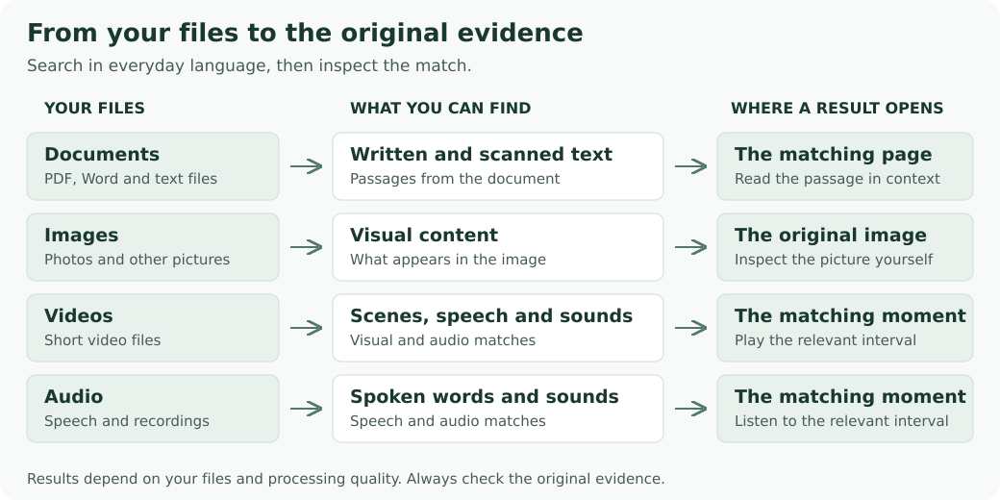
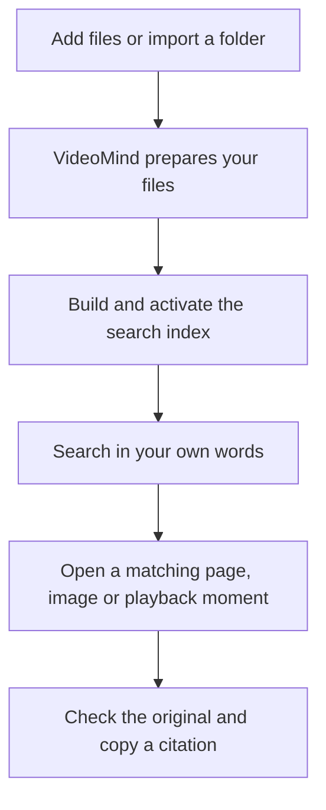
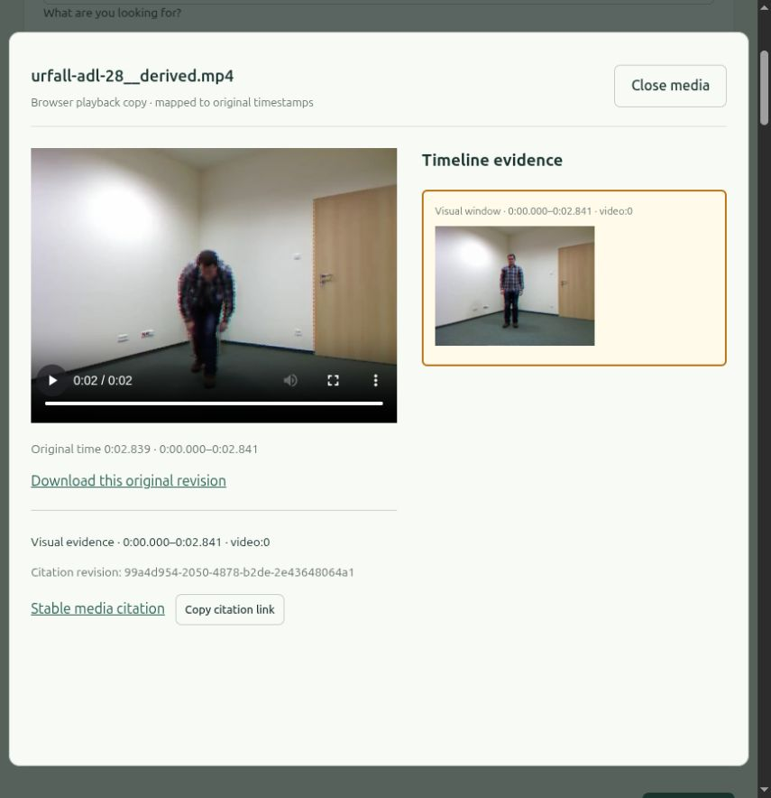
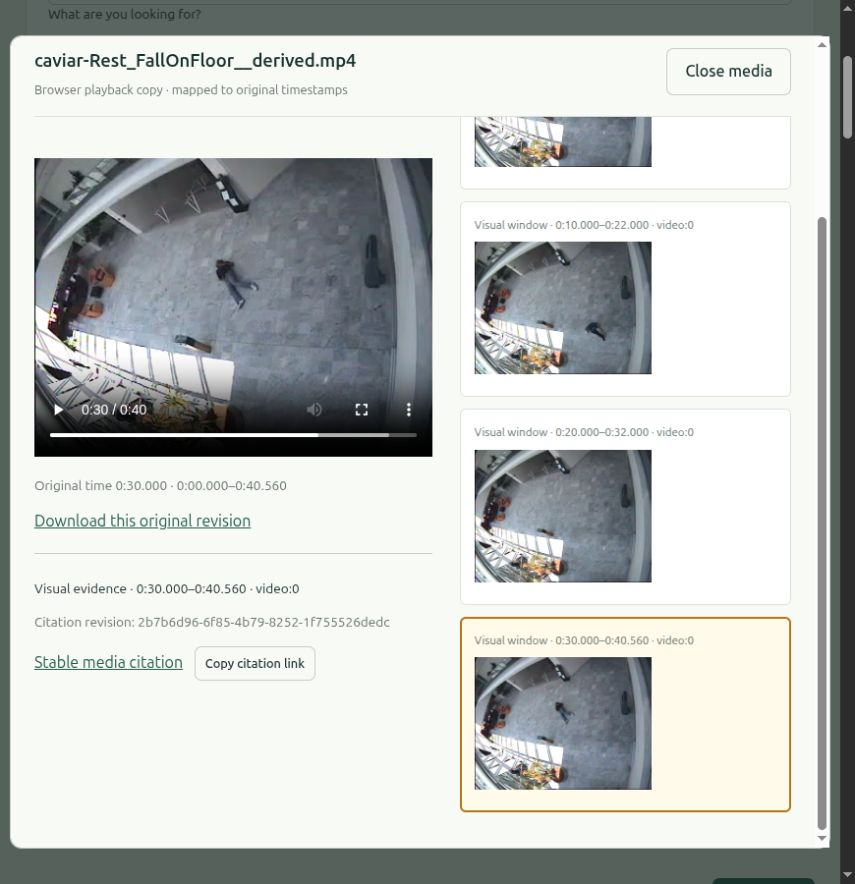
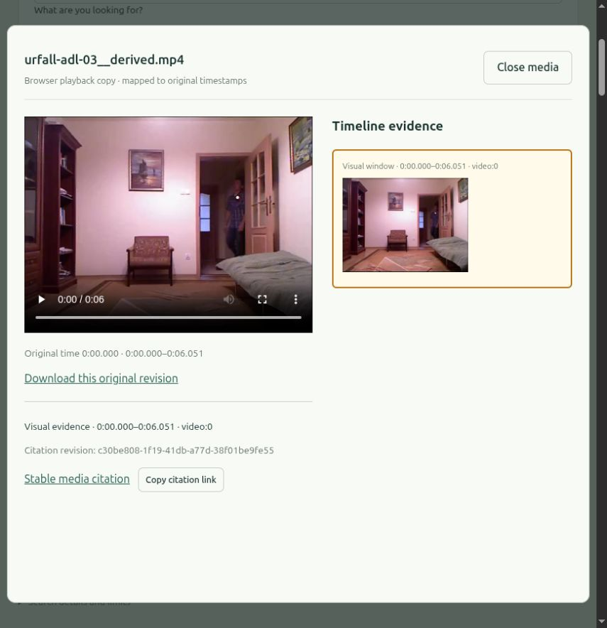
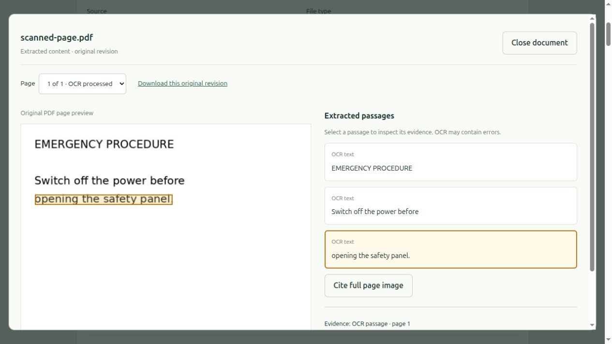

# VideoMind

Search your documents, images, videos and audio in one place, using everyday language. Open a result to see the relevant page, image or moment in the original file.

VideoMind runs on your own computer. You can upload files or import a local folder, then search across them without opening each file yourself.

The project is under active development. It has been tested on a Linux laptop with 16 GB of RAM, using the CPU only. Search quality and speed still need work, especially for finding actions in videos. See the [current evaluation results](docs/phase7-validation.md) for what has and has not passed.

## What you can do

- Find passages in PDFs, Word documents, text files and scanned pages.
- Search images and video scenes by describing what you are looking for.
- Find spoken words and sounds in audio or video.
- Open the page or playback moment behind a result, and copy a citation that links back to it.
- Keep files in separate collections and control who can access them.

For documents, you might search for "cancellation policy". For videos, try descriptions such as "person falling", "person bending down" or "men entering an empty room". Results depend on the files you have added, and some searches may return no useful match.



## How it works



You build and activate the first index once. Later uploads are added to the active index in the background. If a search finds no useful match, try a different description or check whether your files have finished processing.

## A look inside

Search for **"person bending down"**, then choose **Open evidence**. The video player opens beside the timeline, so you can inspect the returned interval and copy its citation.



<details>
<summary>More video examples: falling and entering a room</summary>

**"person falling"** returns a CAVIAR clip with its evidence player open below. The selected 30–40.6-second interval starts after the descent, showing the person on the floor and recovering. This illustrates why you should inspect the video rather than assume a result pinpoints the action.



**"men entering an empty room"** returns the research clip below. It shows one person entering a furnished room; the match does not establish the requested number of people or that the room is empty.



</details>

Video examples use staged research footage. Credits and source terms: [UR Fall](evaluation/manifests/video30-ur-fall-ATTRIBUTION.md) and [CAVIAR](evaluation/manifests/video30-caviar-ATTRIBUTION.md). These are interface examples, not a measure of action-recognition accuracy.

Opening a document result lets you compare the extracted words with the original page. Here, the selected passage is highlighted in a generated scanned document.



The document screenshot uses a generated test file. These captures show the earlier validated interface; the current version separates Search, Library and Settings and opens search evidence beside the results on desktop. Updated captures will follow the full interface validation. Your files and results will differ.

## Before you start

You will need:

- A Linux computer. The current setup has been validated on Linux x86-64; Windows and macOS setup has not been validated.
- Python 3.12 or newer.
- Docker Engine with Compose v2 installed and running. Docker runs the app and its supporting services.
- An internet connection for the first setup, which downloads software and AI models.
- Local ports 8080 and 8000 available. Another app using either port can prevent VideoMind from starting.

A separate graphics card is not required. The tested computer has 16 GB of RAM; this is a reference machine, not a measured minimum requirement. Preparing and searching files can take time on a CPU.

## Start VideoMind

### 1. Start the app

Open a terminal in this project folder and run:

```bash
python3 scripts/dev.py up
```

The first run downloads dependencies and models, prepares storage, and creates your account. Allow time for it to finish. Running the same command again keeps your existing account and files.

### 2. Sign in

Open [http://localhost:8080](http://localhost:8080) in your browser.

Open `.local/owner.json` in a text editor on your computer to find your generated username and password. The `.local` folder is hidden; enable "Show hidden files" in your file manager if needed. Keep this file private.

### 3. Add a few files

Open **Library**, then choose **Add collection → Upload files → Create collection**. Give the collection a name that describes the files. In that collection, choose **Upload files** and select files from your computer.

Start with a small document or a short recording. VideoMind prepares files in the background, and the file list shows their progress.

You can also import a folder. Put your files under `.local/imports/<folder>` and select that folder when adding a source. VideoMind reads from that folder without changing its files. See [folder import details](docs/phase2-validation.md) for sync behavior and limits.

### 4. Prepare files for searching

Open **Settings**. In **Search preparation**, choose **Start indexing**. This builds the searchable version of your prepared files. When indexing finishes and **Make index available** appears, select it to enable search.

If an active index already exists, new uploads are indexed in the background. The panel shows progress and lets administrators retry failed jobs.

### 5. Search and inspect a result

Open **Search** and describe what you need. You can narrow results by collection or file type.

Choose **Open evidence** on a result to view its page, image or playback moment. Use **Search within this file** to explore other matches in the same file. You can also open prepared files directly from the file list.

## Supported files and limits

| File type | Formats |
| --- | --- |
| Documents | PDF, DOCX, UTF-8 TXT, Markdown |
| Images | PNG, JPG, JPEG |
| Video | MP4, WebM |
| Audio | MP3, WAV, M4A, FLAC, OGG |

The current upload limit is **64 MiB per file** (roughly 67 MB). Document processing supports up to **50 pages** for PDFs and rendered Word documents. Audio and video processing supports files up to **five minutes** long. Other processing limits can also cause a file to fail; its status will show an error.

Speech recognition and scanned-text recognition currently use English models. Handwriting, complex page layouts and other languages may produce poor results. Search results should be checked against the original file.

## Stop or restart the app

To stop VideoMind and release its memory:

```bash
python3 scripts/dev.py down
```

Your saved data stays on disk. Start it again with `python3 scripts/dev.py up`.

To check whether the services are running:

```bash
python3 scripts/dev.py status
```

If a file is still being prepared, wait for its status to update before searching. If processing fails, check the reported error and use the retry action when available. The [developer guide](docs/development.md) includes commands for deeper checks.

## Your files and backups

After the initial downloads, normal file processing runs locally. The browser interface is available only on your computer by default. Access from other computers needs a separate secure deployment setup.

Keep `.env`, `.local` and Docker's saved data volumes. They contain credentials and data needed by your installation. Use the normal stop command above; `docker compose down -v` deletes saved volumes.

If you have installed the backend development environment, you can create a local backup with:

```bash
backend/.venv/bin/python scripts/backup.py create
```

Backups contain private data and stay on the same disk. They do not protect against losing that disk. Follow the [backup and recovery guide](docs/local-recovery.md) for setup, verification and recovery limits. Cloning the project does not enable automatic backups.

## For developers

See the [developer guide](docs/development.md) for the code layout, development commands, service behavior and research tools. The [architecture](docs/architecture-proposal.md) and [implementation plan](docs/codex-implementation-plan.md) explain the design and development phases.

The [product and UX plan](docs/product-ux-plan.md) records the interface roadmap. Its first milestone adds Search, Library and Settings navigation and the evidence workspace; preview thumbnails and the later Library improvements are still planned.

Before committing or pushing, enable the [Git safety checks](docs/git-safety.md):

```bash
git config --local core.hooksPath .githooks
python3 scripts/check_repository.py worktree
```
