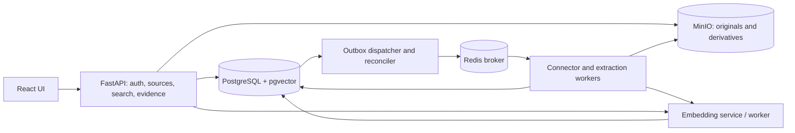

# VideoMind architecture proposal

Status: target architecture; Phases 0–6 implemented and validated locally. Phase 7 local evaluation is authorized; its MVP release gate remains open. Date: 16 October 2026. Updated: 20 October 2026.

Scope update, 18 October 2026: the user's Ryzen 7 7730U laptop with about 15 GiB RAM is the local MVP target. Use CPU inference throughout. GPU support, larger corpora and multi-user scaling are deferred. Phase 0 validated every required input class on this CPU. Phase 1 measured the six-service stack at 244.48 MiB in one idle snapshot; inference was not loaded. Combined peak memory remains unmeasured. See [Phase 1 validation](phase1-validation.md).

## Decision and model validation

Build a modular Python monolith with FastAPI, Celery workers, PostgreSQL/pgvector, MinIO, Redis, and React/TypeScript. Ingestion runs in the background; search responds directly to the user. Each result must point back to the exact source revision and the passage, page or media interval that matched.

Start with one logical embedding space and one physical vector index per embedding profile, spanning modalities. This is the simpler choice for local development because the requested model already aligns the modalities. Keep modality and representation metadata so we can reserve candidates for video or audio if documents crowd them out. Split the physical indexes only when benchmarks show a reason to do so.

The exact requested model, `google/embeddinggemma-2`, is available. Google's model card describes native text, image, video and audio support, a shared 768-dimensional output, and an 8,192-token combined context. It specifies mono 16 kHz audio, default video sampling at 1 fps, text retrieval prompts, and BF16/FP32 inference rather than FP16. Native media embeddings therefore belong in the initial design; OCR and transcripts supplement them. Pin the processor and checkpoint revision before implementation. [Google model card](https://huggingface.co/google/embeddinggemma-2).

The developer guide describes modular encoders and Apache 2.0 weights. The model is an embedder: transcription, OCR, caption generation, and answer generation require separate components. Quantization, truncation, runtime compatibility and actual resource use must be measured locally. [Google developer guide](https://developers.googleblog.com/embeddinggemma-2-the-developer-guide/).

### Assumptions requiring validation

- MVP is a local, trusted-operator installation with multiple application users and workspace boundaries; it is not an internet-ready SaaS deployment.
- Text is the MVP query input. Searching text against raw video/audio is cross-modal retrieval; image/audio query uploads can follow later using the same model adapter.
- English is the initial quality gate. Preserve detected language and Unicode; expand language commitments only after language-specific evaluation.
- Evidence-backed retrieval means users can inspect the passages and media intervals behind a result. Generated answers come later, after we select and evaluate a generator.
- Model weights and approved auxiliary models may be downloaded at setup; normal processing remains local. No source content goes to an external AI service by default.
- Start with a small representative corpus, a single interactive user and a provisional budget of 10,000 vectors. Record actual asset/page/media counts in the evaluation manifest. The earlier 1,000-asset/300,000-vector envelope is a future scaling experiment, not an MVP requirement.

Scope update, 19 October 2026: Phase 3 adopts a 50-page, three-minute extraction budget per document, with the existing 64 MiB original limit, one CPU worker and explicit parser/output bounds. PDF/DOCX/TXT/Markdown produce stored evidence and future search inputs. The document viewer is available before semantic search. Deployment uses pinned Debian document packages from the 18 October 2026 snapshot; these replace Phase 0's project-local Ubuntu tools for the application. See [document validation](phase3-validation.md) for the adopted producer, sandbox, quota and citation behavior.

Scope update, 19 October 2026: Phase 4 adopts a five-minute media limit within the existing 64 MiB upload cap. One CPU worker produces mapped H.264/AAC or WAV playback, native frame/audio windows and local English ASR. Its memory/scratch limits and ten-minute processing deadline are in [media validation](phase4-validation.md). Existing media evidence is inspectable before embedding/search. Physical vector indexes and semantic retrieval remain later phases.

Scope update, 20 October 2026: Phase 5 runs one private CPU embedding service with pinned FP32 weights, a 6.5 GiB container ceiling and bounded requests. PostgreSQL owns durable index jobs and transactional generation publication. The active local generation has 197 vectors for all 46 retained assets, including native standalone-image evidence. The local admission ceiling is 50,000 stored vectors and eight retained generations per workspace; these are containment limits, not measured scale targets. Exact cosine, profile-specific HNSW, cutover/rollback and source-mutation fencing are implemented. Hybrid ranking and the user search interface remain Phase 6. See [embedding validation](phase5-validation.md).

Scope update, 20 October 2026: Phase 6 adds authorized hybrid text-query search, evidence grouping/RRF, filters, bounded context and citation-based document/media viewing. The current 197-vector corpus uses exact cosine as the user-search baseline; the existing HNSW diagnostic remains available. A third literal-identifier branch supplements dense and PostgreSQL FTS candidates. The initial dense relevance floor is 0.70, selected from a small development smoke set. Requests are bounded to 2,000 characters and 30 groups; the shared CPU gate returns a retryable busy response during other heavy work. Per-modality candidate budgets are an API experiment using the same physical storage. Broad relevance, filtered ANN and latency release gates remain Phase 7. See [search validation](phase6-validation.md).

Scope update, 20 October 2026: Phase 7 freezes the 46-asset/197-vector corpus and 30 provisional queries, compares retrieval strategies, tests 1/2/4-fps video windows and rehearses isolated restoration. Fighting remains below the existing relevance floor in the paired sampling diagnostic; no sampling profile was promoted. Batched neighbor resolution reduces repeated scoped queries while preserving final access rechecks. Original gold-set and release thresholds remain in force. See [evaluation evidence and limitations](phase7-validation.md).

Scope update, 20 October 2026: AT0 action-review preparation and AT1 offline window/acceptance comparisons are implemented. Two-second windows improve a demonstrated fall score, with increased ADL admission in the small development pilot. No new producer, model or threshold is adopted for serving; human temporal labels and promotion criteria remain open. See [action/temporal validation](action-temporal-validation.md).

## 1. Requirements and acceptance criteria

All numerical values below are proposed release targets, not observed performance.

### Functional requirements

| ID | Requirement | Acceptance criterion |
|---|---|---|
| F1 | Connect and upload | Upload PDFs, DOCX, TXT/Markdown, PNG/JPEG, MP4/WebM, MP3/WAV/M4A/FLAC/Ogg; scan a read-only allowlisted local folder through the same connector contract. Unsupported or corrupt inputs receive actionable status. |
| F2 | Track ingestion | Show queued, running, ready, partial, failed and deleted states, stage progress, warnings and retry action. Each failed stage records a stable error code and trace ID. |
| F3 | Process every modality | A document passage, a silent visual event, a spoken phrase and a non-speech sound can each be retrieved by a text query in the curated acceptance corpus. |
| F4 | Unified hybrid search | Return one ranked list with source/modality/date/language/tag filters, lexical and dense contributions, and deduplicated evidence groups. Filter combinations are covered by integration fixtures. |
| F5 | Inspect evidence | Every result resolves to an immutable source revision and a page/region, text span or original media interval; readable text is labelled as extracted, transcribed, OCR or generated. |
| F6 | Play original context | Open video/audio at the cited interval, display surrounding transcript when available, and open documents at the cited page or exact TXT span. |
| F7 | Manage lifecycle | Detect unchanged items, ingest changed revisions, resume after worker failure, remove sources and reprocess with a new profile without duplicating published evidence. |
| F8 | Enforce access | The same workspace/source authorization applies to search, facets, thumbnails, jobs, evidence, exports and playback. Unauthorized IDs reveal no content or existence. |
| F9 | Expose reproducible retrieval | Each search response records request ID, active index generation, retrieval configuration and stable citation IDs; it never treats a score as a probability of truth. |

### Nonfunctional requirements

| Concern | Proposed target and verification |
|---|---|
| Latency | Proposed target on the fixed small MVP corpus, one interactive user and a warm CPU model: end-to-end search p95 ≤2 s and p99 ≤5 s, including query embedding and DB work. Record corpus size and available RAM. Larger-corpus and multi-client latency targets are deferred. |
| Local hardware | Use the existing Ryzen 7 7730U, about 15 GiB RAM and SSD. CPU inference is the supported MVP path. Measure the complete stack's peak memory and resource limits; model-only feasibility does not establish the whole-stack budget. |
| Reliability | At-least-once delivery with idempotent writes. All accepted uploads reconcile to a terminal job state after a worker/broker restart; zero duplicate published segments in fault tests. |
| Freshness | Measure CPU ingestion and publication time by modality, including pages/min and media real-time factor. Processing is asynchronous with visible stage progress. The earlier GPU-based 60-second publication target is deferred. |
| Security | Zero unauthorized records in adversarial fixtures. Authorization revocation affects the next API request; proxy media requests are reauthorized per request. No content, credentials or signed links in ordinary logs. |
| Deletion | Search and playback unavailable immediately after committed tombstone. Online DB/object cleanup completes within 24 h for the local corpus; document backup expiry separately. |
| Observability | Trace IDs connect API, outbox, tasks and model calls; expose queue age, stage duration, retries, failures, token overflow, invalid vectors and retrieval latency. |
| Recovery | Demonstrate coordinated PostgreSQL and object-store backup/restore on fixtures. Initial operational target RPO 24 h / RTO 4 h, contingent on configured scheduled backups; Redis is reconstructible. |
| Reproducibility | Locked dependencies and container digests, pinned model revisions, corpus manifests and deterministic segmentation/configuration hashes. Numerical tolerances are documented by device. |

## 2. Modules and deployment



The dispatcher polls durable outbox rows in PostgreSQL. Workers call the same domain services as the API, so publication and access rules have one implementation.

| Module | Responsibility and boundary |
|---|---|
| Identity/access | Workspace membership, source grants, policy evaluation and audit. Supplies authorized query scope. |
| Connectors | External discovery, version tokens, fetching, permissions and tombstones. Knows provider APIs; does not segment or embed. |
| Ingestion orchestration | Durable stage graph, leases, retries, cancellation, quotas and publication. |
| Asset storage | Immutable originals, derivative manifests, hashes, private object keys and retention. |
| Preprocessing | Format detection, parsing, OCR, ASR, media decoding, segmentation and locators. |
| Embedding | Versioned input adapters, batching, budget enforcement, normalization and health checks. |
| Retrieval | Authorized lexical/dense candidates, fusion, diversity, evidence grouping and retrieval traces. |
| Evidence/media | Citation resolution, provenance traversal, document locations and authenticated streaming. |
| Evaluation | Offline corpus/qrels, performance/fault suites and profile promotion reports. |

Use Pydantic for boundary contracts and configuration, SQLAlchemy/Alembic for persistence, structured Python logging, uv and Black. The frontend uses pnpm, Vite, TypeScript and shadcn patterns where useful.

Assign workers by resource needs: I/O, CPU extraction and CPU inference. One internal embedding HTTP service holds the loaded model and batches corpus requests. Start with one heavy inference job at a time and give query requests priority with bounded concurrency. Keep long extraction jobs out of the API and avoid loading a full model in every web worker. GPU worker profiles can be added during later scaling work.

### Proposed folder structure

Organize backend code by responsibility. Keep each module's API routes, contracts and services together; split files further as the module grows. These paths describe the intended layout. Create them as their implementation phases begin.

```text
backend/
  pyproject.toml
  src/videomind/
    main.py
    config.py
    identity/                  # Membership, grants and policy checks
    connectors/
      contracts.py
      upload/
      local_folder/
    ingestion/                 # Stages, publication, leases and reconciliation
    assets/                    # Originals, revisions and object storage
    preprocessing/
      contracts.py
      documents/
      video/
      audio/
    embeddings/                # Model adapters, profiles and input validation
    retrieval/                 # Candidate search, filters, fusion and grouping
    evidence/                  # Anchors, citation resolution and media access
    infrastructure/            # DB sessions, queue wiring and telemetry
    workers/                   # Celery entry points calling module services
  migrations/
  tests/
    unit/
    integration/
    fixtures/
frontend/
  src/
    app/                       # Routing, providers and application shell
    features/
      sources/
      ingestion/
      search/
      evidence/
    components/ui/             # Shared UI primitives
    lib/                       # API transport and shared frontend helpers
evaluation/
  manifests/
  annotations/
  runners/
  reports/
infra/
  compose/
  docker/
docs/
  architecture-proposal.md
  codex-implementation-plan.md
  research/
  decisions/
```

Connectors produce ingestion inputs through `connectors/contracts.py`; they do not import preprocessing or retrieval internals. Preprocessors produce segments and evidence locators through `preprocessing/contracts.py`. Retrieval consumes published data and calls evidence services for authorized result resolution. Worker entry points stay small and delegate business rules to the owning module. Infrastructure supplies database, queue and telemetry adapters without taking ownership of domain rules.

Keep persistence models and repositories with the module that owns the data. Cross-module calls use explicit service interfaces; modules do not reach into another module's repositories. A small application composition layer wires these services together. Add shared helpers only after a concrete need appears, and keep modality-specific code inside its corresponding preprocessing package.

Phase 1 adoption: identity, assets, infrastructure and worker modules now contain implementation; later modules remain deferred. Authentication uses local bootstrap accounts and opaque sessions. The 23 application tables use forced RLS under a restricted runtime role; server-only authentication tables remain separate. Current item access only inherits source grants, and unsupported item ACL modes fail closed. Cross-branch foreign keys validate at commit, and hard evidence deletion cascades to citation identities. The UI exposes sign-in and authorized source listing; ingestion/search/playback await their own phases. [Measured behavior and limitations](phase1-validation.md).

Phase 2 intake adoption: standalone images are a source modality. Source creation, multi-file upload, read-only folder sync, authenticated original download and durable validation status now exist. Received originals use `latest_revision_id`; searchable publication still uses the separate current-generation contract. No file is labelled searchable. See [intake implementation](intake-validation.md) and [Phase 2 completion](phase2-validation.md). Phase 2 adds paged full-manifest adapters, revision-checked fetching, durable source cursors, quota reservations, retention/orphan maintenance and actual process-kill checks. Default workspace admission is 5 GiB/10,000 objects including history and reservations; a one-hour retention floor precedes physical cleanup. Stored originals remain distinct from searchable publication.

### Proposed API contracts

- Source creation/configuration and sync requests return source/job IDs; upload completion returns an immutable revision ID and asynchronous job ID. Client idempotency keys protect repeated submission.
- Job inspection returns stage states, completed/expected work units, capability warnings and stable error codes. A percentage is shown only where total work is known.
- Search accepts query text, workspace/source selectors, typed filters, bounded `top_k` and an optional opaque continuation cursor. Response groups contain asset/revision IDs, matching segment/representation, evidence anchors, citation IDs, snippets/warnings and rank contributions. Continuation pins generation/configuration and is invalidated by policy changes; do not paginate against an unpinned live ranking.
- Citation resolution returns an authorized viewer descriptor; media routes accept Range requests. Retry, reprocess and delete routes enforce their distinct ingest/admin permissions. Request schemas reject unknown filters and oversized queries.

### Connector contract

A connector implements capability discovery, configuration validation, paginated change discovery, immutable item metadata, streaming fetch, optional ACL fetch, and deletion discovery. Its item envelope contains connector ID/version, source ID, external item ID, external revision/ETag, MIME, name, size, source timestamps, content stream reference, permissions and provider cursor. A connector without incremental sync can reconcile full manifests and reports this limitation.

Stage graph: discover → fetch/quarantine → validate/probe → extract → segment → embed → validate manifest → publish. OCR, ASR and visual/audio processing branch after probing; they converge at publication. Persist stage status, attempts, lease expiry, input/output manifests and configuration hashes in PostgreSQL. Commit the discovery/job row and outbox event atomically, then enqueue from the dispatcher. Advance a connector cursor only after its changes are durably recorded, not merely observed. Fetches of unavailable revisions are retried or explicitly superseded.

Use immutable object writes followed by DB references; periodically garbage-collect unreferenced objects. Object keys include workspace and content hash; never expose cross-workspace deduplication. Job identity includes asset revision, stage, extractor/segmenter profile and embedding profile. Database uniqueness and fenced leases prevent concurrent duplicate publication. Bounded retries with backoff handle transient failures; poison items become terminal failures with manual retry. A reconciler re-enqueues expired leases and unsent outbox rows after broker loss. Cancellation and tombstones fence late writes.

Celery late acknowledgement is useful only with idempotent tasks; it does not supply exactly-once semantics. Configure worker-loss behavior and Redis visibility timeout against bounded task duration, then fault-test them. PostgreSQL remains authoritative. [Celery task guidance](https://docs.celeryq.dev/en/stable/userguide/tasks.html).

## 3. Preprocessing and segmentation

Preserve original bytes and checksums. Detect formats from bytes, probe tracks rather than assuming audio exists, and isolate parsers/FFmpeg in restricted containers with time, memory, pixel, page and decompression limits. Disable macros, external document resources and decoder network access. Folder scans reject symlink escapes. Future URL connectors require SSRF controls, redirect checks and egress allowlists.

Every segmentation policy is versioned. The following sizes are initial tuning defaults, not model guarantees.

| Input | Processing and initial segments | Search representations and evidence |
|---|---|---|
| Text PDF/DOCX/TXT/MD | Parse headings, paragraphs, lists and tables; preserve reading order. Target 350–700 model tokens, 50–100 overlap; split on semantic boundaries. Keep table headers with row groups and page mappings. | Text embeddings and FTS; PDF page images provide visual evidence for diagrams/tables. Preserve raw-to-normalized character maps. |
| Scanned or mixed PDF | Detect low text coverage per page; OCR only necessary regions/pages. Render pages and retain rotation, OCR boxes and extraction quality flags. Tile oversized pages with transforms to original page coordinates. | Native page/tile image embeddings plus OCR text. Keep separate representations linked to the same page evidence. |
| DOCX layout | Structural text extraction plus a sandboxed, pinned PDF rendering derivative for stable page citations. | Cite both original revision and rendering profile/page. A render failure permits structural citation with an explicit warning, not an invented original page. |
| Silent video | Decode presentation timestamps; detect shots and cut into 8–16 s windows with ~2 s overlap, splitting long shots. Sample approximately 1 fps, retaining original frame timestamps and visual transitions. | Native video-window embeddings; selected frame image embeddings/OCR only where useful. Thumbnails are evidence previews, not captions asserted as facts. |
| Video with audio | Run the visual path plus audio-track extraction, native audio windows and timestamped ASR. Preserve separate channels/tracks as metadata. | Visual, native-audio and transcript vectors with aligned evidence. Optional jointly embedded A/V windows require an explicit interleaving contract and quality ablation before activation. |
| Standalone audio | Keep original; produce mono 16 kHz derivative with explicit time mapping. ASR via a pinned local Whisper-family adapter; VAD for speech windows of 15–30 s, ~2 s overlap. Also create full-timeline native audio windows for music, silence and non-speech events. | Native audio and transcript vectors; word/utterance timing and optional speaker labels. Do not discard sound events because VAD reports no speech. |

The baseline embeds sampled video frames and the extracted audio separately. Verify how the runtime handles soundtracks before using a combined video call. Sparse sampling can miss a brief action even when the model understands it. Keep frame timestamps and test higher sampling rates on fast-event queries.

Check the processor's actual token count for every input. Enforce a provisional 7,500-token payload ceiling leaving headroom within context; reduce frames, split windows or tiles deterministically before embedding. Never silently truncate a media item. Combined media shares a budget; separate bounded views are the baseline.

Use integer milliseconds on the original presentation timeline and half-open ranges `[start_ms,end_ms)`. Store decode offset, sample rate, frame PTS and derivative mapping. Variable frame rate, nonzero start PTS, resampling and edit lists require explicit fixture tests. Document pages are one-based; boxes are normalized coordinates with rotation/transform metadata; text offsets are half-open Unicode code-point offsets into an identified stored text artifact.

ASR and OCR confidence are extractor-dependent quality indicators. Record producer and calibration status; do not compare them as interchangeable probabilities. Generated captions, if added later, remain labelled derived descriptions with supporting frames. Missing speech/text is a valid outcome; extraction failure is a distinct outcome. Optional branch failure yields `partial`, with explicit searchable capabilities; essential branches cannot silently disappear.

## 4. Embeddings and index generations

Use full 768 dimensions, L2 normalization and cosine distance initially. Query text uses the model's search-query prompt; corpus text uses its document format. Native media follows its processor contract rather than receiving fabricated text prompts. A profile records model repository and immutable revision, processor/tokenizer revisions, library lock hash, prompts, normalization, dimension, precision, encoder loading, sampling, pooling and input-adapter version. Persist the encoded input manifest/hash for audit and reprocessing.

Reject vectors with incorrect length, nonfinite components or near-zero norm. Store vector values as float32 initially, even if inference uses BF16. Batch by modality and token budget; cap batch memory, retry OOM with smaller batches, and bound query/corpus queues to protect latency.

A segment can have several representations, such as transcript and native audio. Store their vectors separately so a result can show which representation matched. Cache embeddings by workspace, profile and canonical input hash.

Model, dimension or preprocessing changes create a new immutable profile and generation. Build alongside the old generation; retain the same source locators, validate coverage and retrieval, then atomically change a workspace's active generation pointer. A query pins that generation for its full lifetime. Never compare vectors across incompatible profiles, even when dimensions match. During backfill, new revisions feed both generations and tombstones apply to both; catch up to a recorded change watermark before cutover. Rollback restores the previous pointer. Garbage collection follows a retention period and active-reference checks.

Raw vector planning: 300,000 × 768 × 4 bytes ≈0.92 GB decimal, excluding row, HNSW, text and metadata overhead. Measure actual disk/RAM footprint and allow at least double-generation capacity during migration. Originals and derived media will usually dominate storage. Dimension reduction or quantization is a later evaluated profile, never an implicit storage conversion.

## 5. Logical database schema

IDs are UUIDs, and every content-bearing row carries `workspace_id`. Common fields include creation time and lifecycle status. Workspace-qualified unique keys and composite foreign keys prevent cross-workspace references. Store authorization relationships in relational columns and tables; reserve JSONB for versioned extension metadata.

| Table | Principal fields and invariants |
|---|---|
| `workspaces`, `principals`, `memberships` | Workspace boundary, application users/groups and membership role. |
| `sources` | Connector kind/version, validated config reference, secret reference, sync cursor, owner, ACL revision, lifecycle. Represents a connection, not a file. |
| `source_grants` | Source, principal/group, permission (`read`, `ingest`, `admin`). Default deny; workspace membership is also required. |
| `assets` | Source, external ID, logical title, modality/MIME, tags, source timestamps, current published revision, tombstone. Unique `(workspace,source,external_id)`. |
| `asset_revisions` | Asset, external revision, SHA-256, original object ID, duration/pages/tracks, size, probe manifest, observed timestamp. Immutable original identity; external token plus content hash handles untrustworthy provider versions. |
| `asset_grants` | Optional item-level restriction for future provider ACLs. When enabled, membership AND source permission AND item permission are required; missing/unknown provider ACL fails closed. |
| `objects` | Private bucket/key, version ID, checksum, byte length, MIME, retention/deletion state. Original or derived artifact role; no stored presigned URLs. |
| `processing_runs`, `stage_runs`, `outbox` | Revision, pipeline profile/hash, branch manifest, stage attempts/lease, status/error, dispatch state. Unique stage identity enforces idempotency. |
| `segment_sets` | Revision, processing run, segmenter profile, readiness/partial capabilities. Immutable segmentation snapshot. |
| `segments` | Segment set, kind, ordinal, parent segment, optional text artifact/span, text, language, quality metadata. Unique ordinal per set/kind. |
| `evidence_anchors` | Revision, original object, locator type, page/box or start/end/track or text-artifact span, transform reference. Typed checks require exactly the relevant locator fields and valid bounds. |
| `segment_evidence` | Segment, anchor, relation (`extracted_from`, `transcribed_from`, `depicts`, `ocr_from`), producer/run and quality. Multiple anchors support cross-page chunks and frame sequences. |
| `segment_relations` | From/to segment, typed relation (`part_of`, `aligned_with`, `overlaps`, `derived_from`), producer, alignment method/quality. Same workspace; prohibit self edges; provenance derivations are acyclic. Temporal alignment does not imply factual support. |
| `embedding_jobs` | Source-scoped generation/asset/revision/set work, attempt, fenced lease, status and manifest. Durable under forced RLS. |
| `embedding_profiles` | Immutable model/input configuration described above, dimension and compatibility identifier. |
| `index_generations`, `generation_assets` | Profile, state, watermark and revision/segment-set membership. Publication replaces an asset membership transactionally; a generation includes only explicitly published segment sets. |
| `workspace_search_state` | Workspace, active generation pointer and policy epoch. |
| `embeddings` | Segment, representation kind, profile, input hash/manifest, `vector(768)`, status. Unique `(workspace,segment,representation,profile,input_hash)`. Physical tables/partitions enforce compatible vector shapes. |
| `searchable_text` | Segment/representation, language configuration, weighted `tsvector`, original searchable text. Separate OCR/transcript provenance retained. |
| `document_pages` | Immutable page text/image/rendering objects, revision and segment-set references, layout/offset mappings and OCR provenance. Forced source/workspace RLS. |
| `media_presentations`, `media_artifacts` | Immutable scoped playback/mapping and complete derivative ownership for each media segment set. Forced RLS; reference-aware retention. |
| `citation_records` | Opaque stable citation ID → segment and evidence anchor IDs/revision; resolution reauthorizes current user. No authorization encoded in ID. |
| `audit_events` | Actor, action, resource IDs, outcome and trace ID; content-free by default. |

Relations: source → assets → immutable revisions → segment sets → segments → embeddings; segments → evidence anchors → original revision/object. Derived objects retain an explicit `derived_from` object/run relationship. Citation records can outlive active search publication but respect current access, deletion and retention.

Indexes: B-tree workspace/source/lifecycle, external IDs, generation membership and profile; GIN on FTS and selected tag metadata; temporal indexes on revision/track/start for playback neighborhoods. Initial exact vector scan supplies the reference baseline; add cosine HNSW after the baseline is validated. Choose partitioning by compatible profile first, then measured tenant/size requirements. Validate query plans: joins for generation and ACL filtering can affect ANN recall and index use.

Publication is a DB transaction: validate object/anchor manifests, mark the segment set ready, replace generation membership and update the published revision. A previous good revision stays searchable while its replacement processes. Deletion immediately tombstones all published membership; cleanup later removes derivatives, vectors and orphaned originals. Reference counting is scoped to authorized storage ownership. Backups may retain deleted bytes until declared expiry; restoration must replay tombstones.

## 6. Retrieval, ranking and authorization

Baseline request path:

1. Authenticate; resolve workspace membership and source grants server-side. Validate query/filter limits. Pin generation and retrieval configuration. UI-supplied workspace/source IDs are selectors, never authority.
2. Apply the same authorized scope, publication membership and requested filters to every branch. Filters include source/asset, original modality, representation, language, tags, source-created/modified date, ingest date and media interval. Date fields have explicit semantics.
3. Embed text once. Retrieve an initial top 150 dense candidates from the active profile and top 150 lexical candidates from extracted text/OCR/transcripts. Exact-rescore the bounded dense pool with cosine before assigning its branch ranks. Dense retrieval spans all representations; lexical retrieval cannot match absent text.
4. Resolve candidates to evidence groups, retaining their matching representations. Within a branch take the best rank per overlapping evidence group so repeated transcript/audio/frame views do not multiply votes. Fuse groups using reciprocal rank fusion: `sum(weight_b / (60 + rank_b))`, initially equal branch weights. These are tunable defaults, not calibrated probabilities.
5. Retain branch traces and merged evidence windows, then enforce a configurable maximum of three results per asset in the first ten, with an explicit "more from this source" view. Do not apply this cap to a single-asset search. Exact rescoring improves candidate ordering; it cannot recover neighbors omitted by ANN.
6. Return top 10 groups with snippets, matched representation, locators, quality warnings, score components and citation IDs. Neighbor expansion is bounded and reauthorized. A later reranker must support the relevant modalities; a text-only reranker cannot fairly reject silent-video matches.

Use PostgreSQL FTS with GIN and `ts_rank_cd` for lexical search. This ranking function differs from BM25. Use language-aware configurations and a `simple` fallback. Add an identifier/substring search path for punctuation-sensitive IDs because stemming and tokenization can lose exact strings. [PostgreSQL text-search controls](https://www.postgresql.org/docs/current/textsearch-controls.html).

ANN filtering needs special care: a SQL authorization filter is mandatory but a filtered HNSW scan can return too few candidates. Use bounded iterative scans/overfetch, inspect filtered recall and fall back to exact search over a sufficiently small authorized set. Never fix candidate scarcity by relaxing access filters. Compare ANN against exact results under the same scope. [pgvector filtering and iterative scans](https://github.com/pgvector/pgvector#filtering).

The MVP returns evidence bundles. It shows "no useful evidence" when a relevance policy, calibrated on negative queries, rejects the candidates. A nearest-neighbor search will return something even for a question the corpus cannot answer; the UI must account for that.

If we add generated answers, select and version the generator separately. Treat retrieved content as untrusted data, cite each factual claim, validate citation resolution and measure unsupported claims.

### Access-control design

Enforce workspace and source policies in application services and PostgreSQL row-level security. The application DB role is neither table owner nor `BYPASSRLS`; use forced policies where appropriate. Set authenticated identity in transaction-local context on pooled connections and reset via transaction boundaries. Apply policies to embeddings, evidence and derived metadata as well as assets. Background roles receive explicit scoped write capabilities. Test the actual deployed role, not an admin connection. PostgreSQL owners and privileged roles can bypass RLS. [PostgreSQL row-security documentation](https://www.postgresql.org/docs/current/ddl-rowsecurity.html).

Recheck current policy before returning materialized candidates and when resolving citations. Cache keys include workspace, principal permission fingerprint/policy epoch, filters, generation and query hash. ACL changes invalidate caches; prototype without shared query caching first. Facets/counts only cover authorized records. Embedding service input/output never enters another workspace's request cache. Redact secrets from connector configuration endpoints.

### Unified versus modality-specific indexes

| Dimension | Unified compatible-profile index | Modality-specific indexes |
|---|---|---|
| Cross-modal matching | One query vector reaches every supported representation. | Fan out the same compatible query to all indexes; merge results. Routing to only one modality loses cross-modal recall. |
| Operations | Fewer indexes and simpler cutover/backup. | More index builds, tuning, generation coverage and monitoring. |
| Retrieval bias | Large transcript/document populations may crowd out video/audio. | Candidate budgets per modality are straightforward, but over-reserving weak modalities can hurt precision. |
| Performance | One ANN call; selective modality/ACL filters may reduce recall. | Smaller graphs and modality-specific tuning; fan-out and merge add tail latency. |
| Ranking | Shared embedding geometry helps, but raw scores still vary by modality and task. | Requires fusion/calibration; physically separate indexes do not fix alignment bias. |
| Evolution | Compatible models only; isolate new profile generations. | Supports specialized incompatible models, each with its own query encoder and separate score/rank fusion. |
| Storage | One physical occurrence per representation; multimodal views still multiply vectors. | Partitioned views need not duplicate storage, but migration and routing are more complex. |

Keep the unified baseline. Compare it with a configuration that retrieves dense candidates per modality and fuses the results using the same storage model. Use the same corpus, candidate budget, hardware and ACL scope for both. Physical separation should earn its extra maintenance cost through better filtering, latency or isolation. Models with the same output dimensions still need separate profiles unless their embedding spaces are proven compatible.

## 7. Playback and citations

Example display: `Operations demo · revision 3 · 00:42.200–00:54.800 · visual match`, or `Safety guide · page 12 · OCR passage`. A citation is an opaque reference to immutable anchors, not a fabricated URL or the model's prose. Every native audio/video hit may carry no transcript; display a preview plus timing instead of inventing a quotation.

Resolve citation → authorize → fetch anchor/original → produce a viewer descriptor. Use an authenticated Range-capable media proxy for MVP to recheck access on every HTTP request. Browser seek time is derived from original PTS mapping, with approximately two seconds of optional context. For unsupported codecs, use a browser-compatible derivative with explicit timeline mapping and an original-download option. A proxy cannot revoke bytes already delivered; revocation is enforced on subsequent requests.

MinIO remains private. Later short-lived presigned links reduce API bandwidth but remain bearer capabilities until expiry, so they weaken immediate revocation. Never save them as citations. [MinIO Python presigned-object API](https://github.com/minio/minio-py/blob/master/docs/API.md).

Documents open original PDF page/region; DOCX uses the pinned rendering derivative; TXT/Markdown uses stored text plus offsets. Store both original and normalized text so highlights survive normalization. Sanitize snippets and document rendering against active content. Deleted or expired originals resolve to an unavailable-evidence state and never silently point at newer content.

## 8. Local MVP

Compose services: React/Vite frontend, FastAPI, PostgreSQL with pgvector, MinIO, Redis, outbox/reconciliation process, CPU Celery worker and embedding service. Keep ASR dependencies isolated and schedule heavy jobs within the measured laptop memory budget. Use a single CPU embedding service. GPU profiles are deferred. Persist DB, object and model caches in named volumes. Health/readiness checks distinguish dependency health, model loaded and ready-to-search status. Expose application ports on loopback by default; secrets use environment/file injection rather than committed values.

Include upload and read-only folder connectors, all four requested modality classes, scanned PDF OCR, local ASR, hybrid text queries, source filters, source grants, job status/retry, citations, document inspection and original-time media playback. Adopted local document limits: 64 MiB originals and 50 pages, with extraction/output bounds described in Phase 3 validation. Larger document and media limits remain proposed scaling work (100 MiB/500 pages; 2 GiB/60 minutes). Validate limits before expensive processing and account for temporary disk use.

Defer cloud connector integrations, live streams, diarization guarantees, arbitrary image/audio query uploads, caption generation, narrative answers, learned reranking, multi-region operation, Kubernetes and compliance certification. The folder connector establishes the connector interface; external providers later add incremental sync and ACL semantics without changing segmentation or retrieval.

## 9. Evaluation and benchmarks

### Datasets and annotation

Use an owned/licensed local gold corpus as the release gate: at least 200 assets (50 per requested source class) and 400 queries. Reserve 60 queries each for documents, silent visual events, spoken video and audio; 60 for mixed-source/cross-modal intent; 40 for exact terms/identifiers; 60 unanswerable or misleading queries. Include scanned pages, tables, transient actions, speechless sounds, accents, noisy audio, hard negatives and conflicting versions. Duplicate this fixture's authorization scenarios across two workspaces and at least three users. Additional languages form separate slices before being advertised.

Annotate relevant source revisions, pages/regions or temporal spans and graded relevance 0–3. Annotate required evidence sets for queries needing several sources; measure complete-set recall. Split assets and near-duplicate source families into development and frozen test sets (roughly half each), not random overlapping segments. Use two annotators with adjudication for ambiguous cases; never let generated labels alone establish the gold set.

External suites provide diagnostic comparisons, not product proof:

- Text: BEIR subsets such as SciFact/NFCorpus and selected multilingual embedding tasks. [BEIR benchmark](https://github.com/beir-cellar/beir).
- Visual documents, video and temporal moments: selected retrieval tasks from MMEB-V2, respecting upstream asset availability and licenses. [MMEB-V2 dataset](https://huggingface.co/datasets/TIGER-Lab/MMEB-V2).
- Native sound/audio retrieval: selected MSEB retrieval tasks, including non-speech examples. [Google Research MSEB](https://github.com/google-research/mseb).

Record dataset revision, licenses, upstream availability and known training contamination. Only publish benchmark-comparable numbers when the official protocol/candidate pools are preserved; label sampled or adapted protocols clearly. Model-card scores do not establish platform latency or evidence accuracy.

### Experiments and release gates

| Area | Experiment and target |
|---|---|
| Retrieval quality | Compare lexical-only, native-dense-only, text-derived-dense-only and hybrid; report macro/per-slice Recall@10 ≥0.85 and nDCG@10 ≥0.70 on answerable local test queries. Hybrid may not regress >0.02 absolute against the stronger baseline on any primary modality slice. Report confidence intervals and inspect failures. |
| Cross-modal coverage | Text queries must retrieve silent visual events and speechless sounds; report each slice separately. Evaluate mixed-source complete-evidence-set Recall@10 ≥0.75. |
| Temporal accuracy | Relevant temporal result requires correct asset and interval IoU ≥0.5 with gold; target Recall@10 ≥0.80. Also report start-time error and short-event misses, where IoU penalizes broad windows. |
| Citations | 100% references resolve to the correct immutable asset revision and valid bounds; ≥95% of judged top relevant evidence anchors actually support the displayed snippet/match description. |
| Abstention | On negative queries, false useful-evidence rate ≤10%; report answerable-query rejection rate alongside it to prevent abstaining on everything. Tune only on development data. |
| ANN | Recall@100 ≥0.95 against exact cosine over the same authorized/filtered corpus. Test filter selectivity at 100%, 10%, 1%, 0.1%, plus fewer-than-k visible results. |
| Index comparison | Unified versus per-modality retrieval at fixed total candidates: quality, p50/p95/p99 latency, graph build time, peak RAM and storage, including modality imbalance. |
| Embedding changes | Ablate native + transcript/OCR views, clip/window sizes, frame rates, 768/512/256 dimensions and precision. Promote only with recorded quality/cost tradeoffs. |
| Performance | For the local MVP, benchmark a fixed representative corpus up to the provisional 10k-vector budget, one client, warm/cold runs and search during background ingestion. Report query embed, DB, fusion, total latency, CPU/RAM/disk, pages/min and media real-time factor. The 100k/300k-vector, 5/10-client and GPU comparisons are deferred scaling work. |
| Playback | All fixture citations seek within ±500 ms of requested time on supported playback derivatives; document page/span mapping passes all fixtures. Measure evidence localization separately from seek accuracy. |
| Security/lifecycle | Zero leaks through search, facets, caches, guessed IDs, jobs or media. Repeat after ACL changes, generation rollback, replacement and deletion; inject worker death, duplicate delivery and broker loss. |

Every report stores code/config/model revisions, corpus manifest, random seeds, resource allocation, candidate budgets and raw measurements. Bootstrap intervals by asset/query family rather than correlated overlapping windows. The first benchmark report establishes feasibility; a missed gate remains visible and requires an explicit scope or hardware decision before release.

## 10. Risks, unknowns and decision gates

| Risk/unknown | Consequence | Resolution before commitment |
|---|---|---|
| Very recent model/runtime support | Processor behavior or media batching differs across libraries. | Phase 0 validates pinned native inputs on actual hardware; no silent substitution with an older text model. |
| Native A/V temporal reasoning | Brief events, order, simultaneous speech and visuals may be weak. | Separate visual/audio evidence baseline; evaluate fast events and joint-input ablation. |
| Shared-space modality bias | Documents overwhelm visual/audio matches or cosine scales differ. | Per-modality quality report and candidate-budget comparison before physical splitting. |
| ASR/OCR error | Wrong names, numbers or timestamps produce misleading snippets. | Preserve originals, label derived text, test noisy/scanned cases and retain confidence provenance. |
| Page and timeline drift | A plausible result opens the wrong evidence. | Immutable anchors, PTS/coordinate mapping and fixture-based seek/render gates. |
| ANN plus restrictive ACLs | Missing authorized candidates and unstable latency. | Exact authorized baseline, iterative scans and measured fallback threshold. |
| Index migration costs | Double storage and incomplete cutover. | Coverage manifest, watermark catch-up, transactional pointer switch and rollback exercise. |
| Local compute and decode cost | Slow ingestion, query starvation, OOM or disk exhaustion. | Resource-limited queues, token-aware batching, storage quotas and reference-host report. |
| Provider ACL semantics | Connector grants could become stale or widen access. | MVP source grants; future provider connectors fail closed and test revocation/sync lag explicitly. |
| Auxiliary model and binary packaging | Download size, licensing or incompatible runtime. | Pin OCR/ASR/FFmpeg/rendering distributions and review licenses in Phase 0; no automatic cloud fallback. |
| Corpus rights and retention | Evaluation assets unavailable or deletion incomplete. | Licensed manifests, storage ownership and declared backup expiry. |
| Target users, languages and scale unknown | Premature optimization or unsupported promises. | Adopt the explicit local envelope above; revise targets using initial corpus/hardware results. |

Implementation phases and their exit criteria are in [codex-implementation-plan.md](codex-implementation-plan.md). Repository agent rules are in [AGENTS.md](../AGENTS.md). Research verification is retained in [model-and-retrieval.md](research/model-and-retrieval.md). No application code is part of this proposal.

## Adopted local recovery follow-up

The local CPU deployment now includes an operator-only transactional content-change journal and independent SQLite export on `recovery-data`, plus snapshot-bound PostgreSQL/object backups and disposable restore commands. The [runbook](local-recovery.md) records the daily Codex schedule, verification and limits. Export is asynchronous (two-second polling, unhealthy after 30 seconds without success), so zero-loss deletion acknowledgement is not claimed. Same-disk copies and a laptop-dependent scheduler do not guarantee the original RPO/RTO targets. Post-backup permission and credential changes require separate review before a real service resumes. No automatic primary replacement or backup expiry is adopted.
