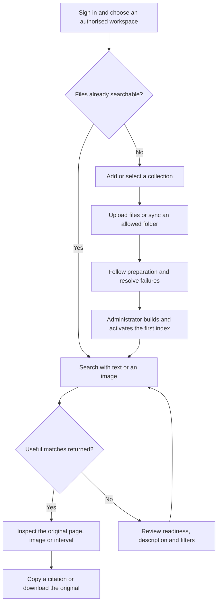

# VideoMind product and UX plan

Date: 21 October 2026. Updated: 26 October 2026. Status: UX0–UX2 and the core preview/Library follow-up are implemented. Current behavior and validation are recorded in [the follow-up report](ux-improvements-validation.md). Remaining UX5/UX6 work includes broader operational help and independent usability/accessibility checks. The original Phase 7 release gate stays open. Screen designs below remain proposals where the report does not record implementation.

## 1. Product purpose and audience

The separately requested [users, roles and workspace management plan](users-roles-plan.md)
specifies proposed owner/admin/member screens, invitations, personal workspaces
and grant management. It extends the original UI scope; its features are not
implemented by the UX0–UX2 milestone.

Help someone answer: **Where in my files does this happen or get mentioned?**

The main journey is add files, find something, inspect the original evidence, then use its reference. The initial audience is a person reviewing a local collection of documents and recordings, with workspace members as a supported secondary audience. This audience choice is a planning assumption, not a completed user-research finding.

The product runs on the existing Linux CPU installation. File preparation remains asynchronous. Search spans documents, images, video and audio. Text and image queries already exist in the current frontend and must remain available.

Product language should promise inspectable matches. It must not promise reliable fall detection, identity recognition, exact action boundaries, generated answers or guaranteed search speed. Research screenshots illustrate returned evidence, including imperfect matches; they are not accuracy measurements.

## 2. Current experience and constraints

This plan is grounded in `App.tsx`, `Search.tsx`, `SourceList.tsx`, the document/media/citation viewers, `IndexStatus.tsx`, and their API contracts, reviewed on the date above.

| Current behavior | Product problem | Planned response |
| --- | --- | --- |
| Search, every collection's files and index management share a long page | Searching and managing files compete for attention | Separate Search, Library and Settings |
| Results use filenames and text without preview images | Visual matches are hard to recognise | Add authorised, bounded previews with text fallbacks |
| Evidence opens in a large modal | Query and surrounding results disappear | A desktop evidence panel and a small-screen evidence view |
| File rows expose validation, extraction and embedding states separately | Users have to interpret internal stages | One primary status with details and a relevant next action |
| First index creation and activation are manual admin actions | First-time users can get stuck before search | A guided, permission-aware setup path |
| Index generations and profile identifiers are prominent | Everyday tasks compete with operator information | Keep controls in administrator settings and details |
| Sources are listed with all their files mounted and polled | Large pages and unnecessary requests | Load a selected collection and pause inactive work |
| The UI has no browser-test setup in its package manifest | Layout refactors risk breaking complete journeys | Add a small scenario-based browser suite |

The Phase 7 assessment is historical and `not_ready`. Its measured relevance and latency misses remain open. Later image-query and recovery work is recorded separately; older plan statements that call every multimodal query input future work are superseded for image queries by the current implementation. Audio/video query uploads remain future work.

## 3. Scope and boundaries

Included: navigation, visual foundations, user-facing terminology, guided first use, collection/file browsing, upload feedback, text/image search presentation, authorised previews, evidence inspection, existing index controls, useful failure states, accessibility, responsive layouts and validation documentation.

Use the existing React, TypeScript, Vite and pnpm setup. Preserve FastAPI, PostgreSQL/pgvector, MinIO, Redis and Celery. Prefer small accessible shared components and shadcn patterns where useful. Do not install an entire component framework or rewrite transport/state management just for appearance. Select any new dependency during UX0, document why it is needed, and update the existing lockfile.

The plan does not add cloud hosting, external AI calls, payment flows, new connectors, chat/generated answers, shared saved searches, persistent search history, collection rename/move APIs, bulk deletion, grant-management screens, new transcription/caption models, waveform generation or a replacement search engine. Existing access controls remain server-enforced. There will be no placeholder buttons for unsupported features.

Changing model profiles, extraction recipes, ranking, the relevance floor, publication rules, media mappings or quota/retention policy belongs to separate work. UI improvements do not waive release criteria.

## 4. Navigation and product vocabulary

| Area | Contents | Access |
| --- | --- | --- |
| Search | Query, filters, results, selected evidence | Workspace members, scoped to accessible collections |
| Library | Collections, selected collection's files, uploads, read-only folder sync and processing detail | Visibility and actions follow current server capabilities |
| Settings | Service status/help for members; storage and search-index controls for administrators | Check server capabilities, never infer permission from a visible button |

Use Collection in the interface for the backend Source concept. Keep source IDs, source grants, connector contracts and API paths unchanged. Library contains collections; it is not a new storage boundary. Workspace switching stays visible only when there are multiple workspaces. Account and sign-out controls remain available without occupying the main content area.

Terminology mapping:

| Current label | User-facing wording | Detail retained where needed |
| --- | --- | --- |
| Add source | Add collection | Upload collection or read-only folder |
| Embedding index | Search preparation | Search-index management in admin settings |
| Indexed | Ready to search | Active-generation membership and partial coverage details |
| Build new generation | Rebuild search index | Building/active/previous generations in advanced details |
| Activate index | Make index available | Explicit admin action after complete eligible membership |
| Open evidence | Open evidence | Describe it as the original page, picture or playback interval |
| Disconnect | Disconnect collection | Explain availability, untouched local originals and the cleanup delay |

## 5. Main user journeys



### First use

1. Sign in with the existing local account flow. Allow password managers and paste; explain where setup stores the account without showing credentials.
2. If no collections exist, show one primary action, Add files. It asks for a collection name and then uses the existing creation/upload endpoints. Offer read-only folder import as a secondary choice.
3. Show files received and their real preparation stages. Keep upload failures distinct from later processing failures.
4. An administrator can start the first index and activate it when eligible membership is complete. Explain unfinished or failed files; never present zero eligible assets as a searchable index. Creation and activation stay explicit, with no automatic policy change.
5. A member without index permissions sees what is missing and is told to contact the workspace administrator. No unusable setup button is shown.
6. Once the active index is ready, offer Search your files. Examples are suggestions, not demonstrations that the corpus contains those events.

### Returning search and verification

Enter a text query or select an image, optionally choose collection/file type, then submit. Show ordered results and open one in the evidence area. Inspect the original page/interval, copy its stable citation or download the original revision. Switch matches and close evidence without losing the query, filters, result order or scroll position.

The example phrases are person falling, person bending down and men entering an empty room. Use the existing public research fixtures for these checks. Record incomplete or incorrect matches honestly; the current falling citation starts after the descent and the room-entry example does not establish multiple people or an empty room.

### Add more files

Open Library, select or create an authorised collection, and choose files or drop them on its upload area. Folder imports retain the current allowlisted `.local/imports` mechanism; do not imply arbitrary host-folder access. New files join the existing processing/publication lifecycle. A new upload need not make the rest of an active index unavailable.

### Recover from a problem

A failed file shows the failed stage, plain-language explanation and an allowed retry. A partially prepared file can still expose available evidence with a visible warning. A disconnected collection explains why it is unavailable without revealing hidden content. Session expiry returns to sign-in and clears sensitive in-memory state.

## 6. Screen design

### Shared shell

A compact left navigation on wider screens contains Search, Library and Settings. The header shows current workspace and account access. A quiet service indicator links to actionable status details. On small screens use a compact header/navigation menu, not a compressed permanent sidebar.

Proposed desktop structure, not an implemented screenshot:

```text
+-------------+------------------------------------------------------+
| VideoMind   | Workspace                                  Account  |
|             +------------------------------------------------------+
| Search      | Query                         Text / Image           |
| Library     | Collection / file type / More filters                 |
| Settings    +--------------------------+---------------------------+
|             | Ordered results          | Selected evidence         |
|             | Preview + title          | Player / page / image     |
|             | Page or time interval    | Matched region/interval   |
|             | Snippet where available  | Copy citation / Original  |
|             |                          | Transcript / Details      |
+-------------+--------------------------+---------------------------+
```

### Search

The initial search view explains the task in one sentence. Keep Text/Image choice near the query, followed by collection and file type; put advanced filters behind More filters. Existing representation, language, all-required tags, dates, media overlap and within-file scope keep their current semantics. Show applied filters in readable text with remove/reset actions only when active. Label filtering that applies to loaded data rather than pretending it covers the entire library.

A result contains a preview or file-type fallback, full readable title, collection, representation label, page or original-time interval, actual snippet when available, and Open evidence. Copy citation and Search within this file remain available. Keep rank order as returned; do not regroup or sort in a way that changes retrieval semantics. Similarity is optional detail, never a confidence percentage. Native visual/audio matches do not receive invented captions or quotations.

Use stable loading placeholders and an announced status. Preserve the last successful results while a replacement request is pending, clearly marking them as previous results; they must not appear to answer the pending query. Replace atomically on success. Prevent older responses from replacing newer requests. If the new search fails, keep the previous query/result relationship explicit.

The current API returns a bounded top set, not a paginated catalogue of matches. Do not add fake result totals, server-wide result sorting or endless scrolling without a separate contract.

### Library

The overview lists accessible collections and their connector type. Open a collection to load its paginated files. File rows show filename, type, size, primary preparation state and a relevant open/retry action. File details reveal exact stages, warnings and revision information.

Uploads support the file chooser and a keyboard-accessible drop area. Validate documented formats and size before submission, but keep server validation authoritative. Preserve successful earlier uploads if a later file fails. Show per-file outcomes, clear partial-batch wording and retry only failed submissions. The current sequential upload transport stays bounded; resumable upload, cancellation and per-byte progress require their own contracts and are not implied.

Keep 50-file pagination and current cursors. Initially use collection selection rather than inventing a global Library search API. Any filename/type filter over loaded rows must say it filters loaded files. Collection totals must come from an authorised count, not the length of one page. Disconnect stays in collection actions with the existing consequences and confirmation. Downloads have explicit labels instead of making a filename unexpectedly download content.

### Evidence workspace

On a wide screen, a result opens in a nonmodal evidence panel alongside the result list. On narrower screens, use a dedicated evidence view with a clear Back to results action. The switch occurs when both panes no longer fit, with 1100 CSS pixels as a starting breakpoint to validate. Within a compact viewer, stack media/page and timeline/passages rather than nesting another narrow split.

For video/audio, seek to the resolved citation's original interval using the existing mapped playback. Show current original time and visibly mark the selected interval. Distinguish the citation interval from the current playback position; seeking elsewhere must not silently rewrite the copied citation. Expose transcript where it exists and label speech-recognition errors. A visual window is sampled evidence, not a detected action boundary. No autoplay on opening a result and no generated waveform or frame precision claim.

For documents, open the cited page/span, bring the passage into view and preserve OCR labels, selected-region visibility, Unicode offsets and original/rendered download choices. Standalone images open through the existing authorised revision/evidence path. Display important partial-processing warnings beside content, even when technical details are collapsed.

All evidence types keep Copy citation, a clear success/error state and Open/download original actions. Technical IDs, producer details and scores belong under Details. Public opening of a copied citation still requires the recipient to have access.

### Settings and help

Members can inspect coarse service availability and read local setup/help. Administrators can inspect storage and manage existing build, retry, activate and restore-index operations. Explain that restoring a previous generation is not restoring deleted files. Keep current capacity limits and catch-up requirements. Do not infer administrator-wide counts for members or add user-management and backup-run buttons that have no authorised application APIs.

Show the local-processing explanation accurately: initial model/software downloads use the internet; normal processing is local. This is not an internet-ready shared deployment.

## 7. State and error model

| Situation | Display and action |
| --- | --- |
| No accessible collections | Permission-appropriate Add collection or contact-admin guidance |
| Preparing a file | Primary Preparing state and expandable actual stage/counts |
| Active publication exists | Ready to search; retain any partial-processing warning |
| Embedded but unpublished | Waiting for index activation, not Ready to search |
| Failed stage | Needs attention, stage-specific error and authorised retry |
| Some representations failed | Available with limitations; explain missing content |
| No active index | Explain first setup or administrator action without suggesting service failure |
| No accepted search evidence | No useful matches; edit description or filters, without asserting absence in the files |
| Model busy | Retryable search-busy message; do not claim a known cause unless provided by the server |
| Slow/model-loading request | Explain CPU preparation may take time; no invented countdown or stage telemetry |
| Lost connection or timeout | Search unavailable, manual retry and local status/help |
| Hidden/deleted/revoked evidence | Generic evidence unavailable; no hidden filenames, thumbnails or counts |
| Session expired | Clear sensitive UI state and return to sign-in |
| Clipboard denied | Offer the citation as selectable text |

Create a single tested presentation mapper for file states. Failed mandatory stages take precedence over pending stages. Ready to search requires active membership; it is not inferred from a successful extraction or completed embedding job. A ready file can also have limitations, and a new pending revision can coexist with a previously searchable revision. Do not claim the latest version is searchable until its membership is confirmed.

Counts and progress use server-provided units. Unknown progress is indeterminate. Percentages may describe an explicit known count, not elapsed time or an invented end-to-end completion estimate.

## 8. Frontend and API work

### Frontend structure

Keep existing feature ownership. Add shared shell/navigation and small controls under `app` and `components/ui`; split Search into query controls, ordered results and result items. Keep collection intake within `features/sources`, add Library composition, and reuse index management from `features/indexes` inside Settings. Extract reusable document/media viewer content from modal containers so citation resolution has one implementation across panel, direct-link and small-screen layouts.

Centralise response types currently duplicated between components. Keep the shared API transport; handle structured errors safely. Store query, results, selected citation and scroll position in workspace-scoped memory. Clear that state, image object URLs and previews on sign-out, session expiry or workspace/access change. Avoid persistent caches containing content, queries or image uploads.

Use client navigation with proposed `/search`, `/library` and `/settings` routes. Preserve the existing `/?workspace=...&source=...&citation=...` citation format and resolve its workspace against current authorised membership before opening evidence. Preserve authentication checks and original revision/set identity. Internal navigation identifiers are not authorisation. Browser Back/Forward must close/reopen evidence appropriately and restore the parent view; old citation links work after refresh. Do not put query text or image payloads in URLs, logs, analytics or local storage.

### Contract additions and reuse

| Capability | Current support | Planned treatment |
| --- | --- | --- |
| Text/image search and facets | Already supported | Preserve payload limits, filters, ranking, warnings and provenance |
| Processing/readiness | Asset stages, embedding state, search progress/facets; admin-only index coverage | Reuse these; normalise presentation without exposing admin totals |
| Collection/file actions | Creation, upload, folder sync, pagination, retry, disconnect, original download | Reuse existing permission checks and endpoints |
| Evidence | Citation resolution, page/object views, mapped Range playback | Refactor presentation while retaining authorised contracts |
| Preview on a search result | No preview field in `EvidenceResult` | Add an optional scoped preview descriptor or a bounded batch-preview resolver; select and freeze one design in UX0 |
| Library previews | No general thumbnail field on asset listing | Prefer type fallback initially; reuse a bounded descriptor only where supported without per-file hydration |
| Upload progress | Sequential request completion, no durable resumable protocol | Report files received and stage counts; no fake byte-progress/cancel controls |
| Backups, membership editing, collection rename/move | No corresponding UI capability in this scope | Link help where appropriate; no new control or API |

For previews, prefer existing registered page images, native image previews and sampled video frames. An audio type fallback is sufficient. Select a representative preview deterministically from the matching revision and segment set, not the latest unrelated file revision. A sampled frame need not depict the action or occur exactly at the citation start; label its timestamp if available.

A preview descriptor can contain a same-origin authorised path, kind and optional page/sample time. It must not contain raw storage keys, embedded content, credentials or signed public links. Resolve candidates in a bounded runtime-role query batch, scope every object/segment/reference to workspace/source/revision/set, recheck authorisation on byte delivery and retain generic unavailable behavior. Limit requests to visible results, lazy-load previews, bound concurrency and cancel stale loads. Do not list all pages/segments per search hit or eagerly download full-size originals for thumbnails.

If a derivative does not exist, show a fallback. Do not add a new image/model producer on the API request path. Any future persisted thumbnail producer needs explicit quota/storage-lock/retention treatment and a separate scoped decision. No new database migration is assumed for this UI plan.

## 9. Visual and accessibility direction

Use a calm research workspace with neutral surfaces, restrained green emphasis, clear text and enough room for original evidence. Start with semantic colour, type, spacing, radius, border and focus tokens. Use a 4/8-pixel spacing scale, approximately 16-pixel body copy and readable secondary labels. Keep a system font stack and locally bundled assets. Icons supplement visible labels and must come from one maintained set; decorative controls add no value.

Design complete default, hover, focus, disabled, loading, selected, error and unavailable states. Disabled does not automatically mean busy. Use skeletons only while content is actually loading. Respect reduced motion and avoid decorative animation. Dark mode can follow after the core journey is validated; it is not part of the first delivery.

Validate at 360, 768, 1024 and 1440 CSS-pixel widths, plus reflow at 320 CSS pixels and browser zoom. Exact breakpoints are implementation details to adjust after inspecting real filenames and evidence. Preserve readable text and usable media controls without horizontal page scrolling. Use semantic navigation and headings, keyboard-operable filters and uploads, visible focus, accessible names and live status announcements. Modal creation/confirmation dialogs trap focus and restore it; the desktop evidence panel remains nonmodal with deliberate focus movement and a return action.

Target the applicable WCAG 2.2 AA criteria for the application interface, including keyboard operation, reflow, contrast, target sizes and status messages. Test them rather than claiming compliance from a component library. Imported media may lack captions or accessible descriptions; ASR may be incomplete or incorrect. Record those limits, offer available text/original alternatives, and do not claim full content accessibility.

The rationale for hiding rare technical options follows [NN/g's progressive disclosure guidance](https://www.nngroup.com/articles/progressive-disclosure/). Interface accessibility checks use the [W3C WCAG 2.2 reference](https://www.w3.org/WAI/WCAG22/quickref/). These support the proposed design choices; they are not measurements of VideoMind's usability.

## 10. Implementation sequence

UX0–UX6 are product-work identifiers, not replacements for platform Phases 0–7. Each step delivers a reviewable change, records validation and retains a functioning app. Read the applicable phase validation and acceptance reports before implementation. UX0 precedes all others; UX1/UX2 establish the core journey; UX3–UX5 complete it; UX6 closes the interface delivery.

| Step | Dependencies | Deliverable | Exit check |
| --- | --- | --- | --- |
| UX0: specify and baseline | Existing Phases 2–6 and this plan | Low-fidelity Search/Library/Settings/evidence layouts; state/status mapper specification; route/history design; preview contract choice; scoped test/dependency decisions | Layouts cover empty, ready, pending, failure, partial, denied and mobile states; baseline fixtures/citation identities recorded privately; no policy change |
| UX1: navigation and visual foundations | UX0 | Shared tokens/controls, Search/Library/Settings shell, workspace/account navigation, UI terminology | All existing actions remain reachable for their authorised roles; deep links, keyboard navigation and workspace changes work; build passes |
| UX2: Search and evidence journey | UX1 | Text/image controls, filters, compact ordered results, shared nonmodal/full-view evidence, citation actions and request-race handling | Search → open → inspect → copy → return works for all four modalities; exact old citations and media mappings preserved |
| UX3: authorised result previews | UX0 contract and UX2 results | Optional bounded preview contract, visible-result lazy loading, placeholders and denial handling | Correct revision/set previews; no hidden-source leakage or per-hit full hydration; search order/content unchanged; Range and ordinary evidence still work |
| UX4: Library and first use | UX1 and UX2 | Selected-collection browsing, file rows/details, accessible uploads, real preparation states and admin/member onboarding | Upload → prepare → explicit initial activation → search works; partial batches, pagination, failed-stage retries and read-only sync are clear |
| UX5: operational clarity | UX4 | Settings for existing index controls, scoped storage, useful service/errors/help and interruption recovery | Build/retry/activate/restore remain authorised and truthful; failed activation is explained; no invented admin/member capabilities |
| UX6: full validation and documentation | UX2–UX5 | Responsive/accessibility pass, browser journeys, access regressions, before/after captures, refreshed README and validation report | All required checks in the UX validation checklist have recorded outcomes; limitations recorded; Phase 7 gate remains separately reported |

First review milestone: UX0–UX2, with working Search and Library navigation and evidence inspection using existing APIs/type placeholders. Second milestone: UX3–UX5, with real previews and complete first-use/management paths. Final milestone: UX6 and the full validation report. Do not present intermediate placeholders as completed previews.

No duration is promised before UX0 resolves the preview contract and viewer refactor. Keep changes small enough to review and revert by step. Commit only when requested, using repository conventions. Deployment and push remain separate actions.

Implementation risks and decisions to settle in UX0:

| Risk or open choice | Resolution and fallback |
| --- | --- |
| Preview hydration adds retrieval work | Compare an additive descriptor with a bounded batch resolver; select one, measure lookup bounds and retain type fallbacks |
| Refactoring modal viewers breaks old citations or time mapping | Share viewer content, preserve resolution logic, and establish direct-link/Range/nonzero-origin regressions before replacing containers |
| Navigation unmounts active uploads or drops result state | Keep the upload owner mounted while submissions are active or explain/block navigation; scope search state to the workspace and test browser history |
| Simplified status hides partial or old-version evidence | Specify status precedence using revision membership and stage failures; test pending replacement and partial-ready cases explicitly |
| Busy CPU work makes setup or search appear stuck | Use existing known states and manual retries; avoid new aggressive polling, blanket automatic search retries or invented completion estimates |
| Imported media lacks accessible alternatives | Expose existing transcripts and warnings; record content limitations independently of interface checks |

UX0 should record the chosen route/history mechanism, preview contract and test runner in this document or a linked decision note. Update affected acceptance checks when a choice changes; do not silently expand the scope.

## First-milestone implementation decisions

The 21 October 2026 implementation starts with UX0–UX2. These decisions apply to that milestone:

- Use a small typed History API adapter for `/search`, `/library` and `/settings`, with `popstate` handling. Keep query/results/image data in workspace-scoped component memory, and keep an already-visited Library mounted so navigation does not interrupt an upload. Pause inactive collection/facet polling. Library still uses the existing per-collection file lists; selecting one collection at a time is UX4.
- Resolve legacy citation URLs against authorised workspace membership, validate identifier shapes before resolving, and keep source/citation identifiers in navigation URLs. Search text and image bytes are never included. A workspace key resets sensitive view state on switching or sign-out.
- Reuse one evidence resolver and shared document/media content inside either a dialog or a nonmodal Search panel. At 1100 CSS pixels and below the panel becomes a dedicated full-screen view. Make the background inert there, restore focus to the invoking control, and retain ordinary dialogs for Library inspection.
- Keep result order and the backend search payload unchanged. Label retained results with the submitted query and scope, distinguish them while a replacement request is pending, and ignore stale responses after mode/file changes. Use file-type text fallbacks until previews are implemented.
- For UX3, choose an additive optional preview descriptor on each returned result, populated in one bounded authorised metadata batch. It will reference existing same-origin evidence byte endpoints for the matching revision/set. Do not add per-hit document/segment-list hydration or a new derivative producer. The exact backend type and isolation tests belong to UX3; no preview field has been added in this milestone.
- Keep the file-status precedence specified in section 7 for UX4. Current `embedding_status=indexed` describes latest-revision active membership; other completed stages do not imply readiness. The current asset list cannot establish that an older revision remains searchable, so do not invent that claim from the latest revision's pending state.
- Add only the pinned `@playwright/test` 1.62.1 development dependency. The suite uses installed Google Chrome with synthetic intercepted API responses and a separate loopback Vite server. Browser artifacts stay under ignored `.local/ux-browser-tests`; full traces are disabled. The command is `pnpm --dir frontend test:ui`. Real-stack browser checks are separate and do not use mocked responses.
- Keep the existing system font stack and use CSS tokens/shared native controls rather than installing a visual framework. Search-index actions are now located in Settings, but wider operational/Library improvements remain UX4–UX5.

See [the validation record](product-ux-validation.md) for the checks run and the limits of this milestone. No model, ranking, extraction, storage or publication policy has changed.

## 11. Verification and completion

Use [the UX validation checklist](product-ux-validation.md) as the execution record. It records the first milestone separately from the pending complete interface validation. Historical test results are not substituted for new checks.

During implementation, run the frontend strict build and targeted browser scenarios for each affected journey. Use a small test-only browser harness with deterministic API fixtures for state/race/error cases and actual local-stack checks for authentication, publication, evidence and Range behavior. Mock success cannot prove authorisation or real-model relevance. Run shared-API runtime-role tests when adding preview contracts, then the repository-required running-stack verification before the completed interface delivery. Run real-model examples serially, separate from worker-heavy validation, and record CPU-busy responses as failures/retryable states rather than silently excluding them.

Record exact commands, versions, outcomes, limitations, fixture scope and changed decisions in the validation document. Use synthetic or licensed public screenshots with attribution and visual/metadata inspection. Keep private originals, credentials, signed links, query logs and generated private data out of version control. Run repository leak checks and staged-diff checks before any requested commit, followed by history checks before push.

A successful UI release means the supported journeys are understandable, responsive, accessible to the tested extent and preserve backend correctness. It does not mean the original platform release gate, broad action quality, concurrent CPU capacity or recovery guarantees have passed.

## 12. Product validation and later decisions

After the core journey works, conduct task-based sessions with representative users. Record consented observations locally without introducing analytics that collect query text or file contents. Proposed tasks: add a file, understand its readiness, find a document passage, inspect a video interval, copy/reopen a citation, recover from a failed file and explain an imperfect match. Include an administrator and a member with restricted collections.

Record completion without assistance, points of confusion, navigation mistakes and whether users distinguish a match from a verified event. These are proposed evaluation measures with no current results or invented success rate. Resolve repeated blockers before visual polish is declared complete.

Revisit audience-specific workflows, saved references, advanced organisation, dark mode or team administration only after these sessions identify a concrete need. New actions must have a supported backend capability and an access model before they receive a button.

## Related documents

- [Architecture and invariants](architecture-proposal.md)
- [Platform implementation plan](codex-implementation-plan.md)
- [Intake and retention validation](phase2-validation.md), [acceptance report](../evaluation/reports/phase2-completion.json)
- [Document evidence validation](phase3-validation.md), [acceptance report](../evaluation/reports/phase3-completion.json)
- [Media validation](phase4-validation.md), [acceptance report](../evaluation/reports/phase4-completion.json)
- [Embedding lifecycle validation](phase5-validation.md), [acceptance report](../evaluation/reports/phase5-completion.json)
- [Search validation](phase6-validation.md), [acceptance report](../evaluation/reports/phase6-completion.json)
- [Phase 7 findings](phase7-validation.md) and [historical assessment](../evaluation/reports/phase7-assessment.json)
- [Action/temporal limits](action-temporal-validation.md)
- [Local recovery](local-recovery.md)

## Adopted follow-up, 26 October 2026

The user authorized the proposed core-journey improvements. The implementation
adds the UX3 preview descriptor/batch, UX4 file intake/status/collection selection,
and search/evidence refinements. Search becomes the default home; signup still
opens Library. First-use instructions now reflect the implemented self-service
policy rather than assuming every workspace needs manual initial activation.
Preview images reuse existing PNG/JPEG evidence objects up to 4 MiB, with three
concurrent visible/proximate requests. No new derivative producer is adopted.
See [current behavior and validation](ux-improvements-validation.md); full UX6
acceptance and independent user sessions are not declared complete.
