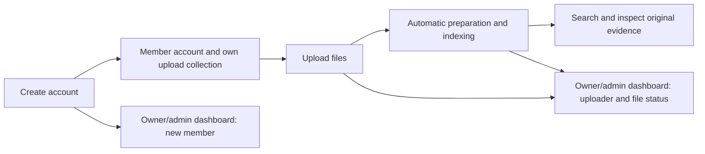

# Self-service members and administrative analytics

26 October 2026. Status: S1–S6 implemented and validated within the local deployment scope.
Implementation details and measured checks are recorded in
[self-service-validation.md](self-service-validation.md).
This supersedes invitation-first onboarding and the restriction that only
administrators can create upload collections in the earlier users/roles plan.
The existing owner/admin/member demo accounts remain available and unchanged.

## 1. Product experience

Members use the product to add their files and find relevant evidence. Owners and
admins monitor the workspace, its members and file preparation. Analytics is an
administrative area, not the member landing page.

The default signup destination is the installation's configured shared workspace.
Each new member receives an initial upload collection that other ordinary members
cannot access. Workspace owners/admins can access it, and the signup form must
say so. A separate private workspace per signup is not assumed or created.
Existing collections are never automatically shared with new accounts.

## 2. Role-specific navigation and powers

| Area | Owner | Admin | Member |
| --- | --- | --- | --- |
| Dashboard / analytics | Workspace overview and activity | Workspace overview and activity | Not shown; endpoint access denied |
| People | New/existing members, roles and activity; owner controls admin roles | Members and their activity; manage ordinary members within authorized limits | Own account only |
| Library | All workspace collections | All workspace collections | Own collections and explicitly shared collections |
| Add upload collection | Yes | Yes | Yes, scoped to the creating member |
| Upload and prepare files | All collections | All collections | Own collections and shared collections with Contributor/manager access |
| Search and inspect evidence | All workspace content | All workspace content | Authorized content only |
| Processing and indexing | Workspace-wide operations and failures | Workspace-wide operations and failures | Track/retry preparation of writable files; indexing runs automatically |
| Advanced index rebuild/activation/rollback | Yes | Yes | No workspace-wide lifecycle powers |
| Workspace storage totals | Yes | Yes | Relevant upload limits/errors and own file statuses |
| Account settings and appearance | Own account | Own account | Own account |
| Ownership/admin-role changes | Owner only | No | No |

Role is attached to workspace membership. Creating an account always creates an
ordinary member; clients cannot submit an owner/admin role, another workspace
destination, another uploader identity or grants to existing private files.

Members can create their own upload collections without learning any host-folder
paths. Local-folder imports remain an explicit administrator operation. New own
collections receive a source-scoped management grant, not workspace admin powers.
Existing Viewer-only shares remain read-only, while those users can still create
their own writable collection and use the full member journey.

## 3. New member journey

1. Sign-in offers **Create account** when registration is enabled for this
   installation. Signup asks for username, password and password confirmation.
   Usernames/passwords follow a documented policy; no social login or email
   verification is implied without an actual provider/recovery implementation.
2. Explain the data boundary before submission: the member's own collection is
   hidden from other members and visible to workspace owners/admins. Do not
   promise privacy against the local machine/database operator.
3. The backend validates registration policy, capacity and username availability,
   then creates account, member membership and initial collection/grant atomically.
   Failure leaves no partial account. Duplicate submissions cannot duplicate
   memberships/collections. Authentication sessions use the existing secure flow.
4. Sign in and show **Upload your first files** in Library. The first upload does
   not require an operator to create an account, assign grants or manually run an
   indexing command.
5. Show real upload, validation, extraction and indexing progress. Individual
   errors have a supported retry, while successful files remain available.
6. Once published into the active index, the file is labelled **Ready to search**.
   The user can search with text/image input and inspect mapped original evidence.

Registration needs server-side throttling, bounded password hashing, workspace
membership/storage/collection limits and an operator-configured destination.
Fail closed if registration is disabled, configuration is missing, the workspace
has no valid owner or capacity is exhausted. An owner can control enrollment
within the configured workspace. Administrative accounts are never self-issued.
Local deployment remains loopback-only; internet hosting retains separate TLS,
abuse prevention, recovery and deployment requirements.

## 4. Owner and admin Dashboard

Use a dedicated **Dashboard** navigation item for authorized administrators.
Search/Library stay available for their own file work. Dashboard is the
administrative landing page; members land in Search or first-upload onboarding.
All values come from an authenticated workspace-scoped API. Hiding navigation is
not sufficient authorization.

### Overview

- Active members, with a separate count of recently joined members.
- Current files and files uploaded in the selected period.
- Ready-to-search, preparing and failed files, with partial extraction identified.
- Workspace storage consumption against the actual configured quota.
- A real upload/join trend for a bounded date range, only when timestamp data is
  available. No simulated charts or inferred historical activity.

### Recent members

Show username, role, known join time and their attributed upload/indexing counts.
The owner/admin can open a member's activity to see that member's files and their
current processing state. Historical unknown join times display as unknown; a
migration timestamp must not be represented as the person's signup date.

The owner also controls administrator role assignment and ownership under the
existing owner-only policy. Admins manage ordinary members within their allowed
scope. Those mutation controls must be implemented and tested before appearing;
the existing People directory remains read-only until then.

### Recent uploads and indexing activity

Each row shows filename, collection, actual uploader, received time, current stage
and an allowed Open/retry action. Filters include member, date range, modality and
state. Lists need bounded paging. Administrators can inspect the original or
processing details without switching into another person's login.

Track stage progress through Upload received → Validating → Preparing content →
Indexing → Ready to search. Failures identify the failed stage; partial evidence
is labelled separately. **Ready** means the current nondeleted file revision has
complete active-generation membership, not merely that an upload or embedding
request returned successfully. Do not count retries or vector parts as new files.

## 5. Activity data and attribution

- Persist real workspace join time for new memberships. Existing unknown history
  stays unknown unless reliable records establish it.
- Record the actual authenticated uploader for each immutable source revision at
  original-ingestion commit. Never trust client-supplied uploader/owner fields.
- Keep upload attribution separate from a worker's processing identity, source
  manager and later sharing changes. Folder imports identify the initiating
  account/system importer explicitly.
- Backfill existing uploader attribution only from reliable original validation
  job/request records. Otherwise show **Unknown**; filenames and collection names
  are not evidence of who uploaded a file.
- Define whether totals count active files or historical uploads. Default cards
  count current nondeleted assets/latest revisions; historical revision activity
  is separately labelled. Deleted/disconnected content is excluded from active
  counts, while retention follows the established policy.
- Store timestamps consistently and display timezone-aware dates. Bound date
  ranges and returned rows; use cursor paging and appropriate indexes.
- Administrative analytics stays behind workspace admin authorization and the
  restricted runtime database role. No aggregate counts, usernames, private file
  titles or processing inventories are returned to an ordinary member.
- Passwords, session tokens, source content and signed URLs never enter ordinary
  analytics logs. No persistent member search history is added by this work.

## 6. Automatic indexing and resource control

Members upload, see status and retry their authorized files. Normal indexing is
an automatic worker task using the current configured embedding profile.
No member has to rebuild or activate the shared workspace index after each upload.

For a workspace with no active index, provision a bounded system-managed initial
index setup/publication path. Preserve complete-generation publication, source
grants, profile compatibility, immutable citations and worker idempotency. Do not
activate zero eligible files or let a member's request choose a global model,
replace another user's generation or bypass administrative authority. This part
requires the Phase 5 validation/contracts before implementation.

Global rebuilds, profile changes and restoring previous generations remain in
owner/admin advanced settings. CPU-busy errors, admission limits and processing
failures must remain explicit rather than claiming every upload is immediately
searchable. Existing storage reservations and cleanup locking stay intact.

## 7. Implementation sequence and acceptance

| Step | Deliverable | Acceptance |
| --- | --- | --- |
| S1 | Revised role/signup policy, registration configuration and attribution schema | Current accounts, grants, originals and active index preserved; safe migration; owner-only enrollment control |
| S2 | Signup backend and UI, member account/default collection/session | Anonymous signup success; duplicate/concurrent signup; disabled/full workspace; rate limits; partial-failure rollback; no role/workspace spoofing or secret disclosure |
| S3 | Member collection creation and automatic preparation journey | New member uploads and searches without operator work; first-index setup; read-only shares remain read-only; member cannot change workspace-wide index/model settings |
| S4 | Authorized dashboard APIs and real analytics UI | Accurate current-state counts and uploader attribution; new-member and upload activity; paging/filtering; empty/loading/failure states; no member analytics access |
| S5 | Owner/admin membership management | Owner manages admins; admin limited to members; last-owner protection; immediate revocation; no cross-workspace escalation |
| S6 | End-to-end validation and documentation | Owner/admin/two-member plus new-signup desktop/mobile journeys, direct API/runtime-role isolation, upload/index failures and retries, revocation, preservation and leakage checks |

The existing demo members remain useful regression accounts: a Viewer must be
able to create a separate writable collection while their existing read-only
share stays read-only. Existing historical validation results remain historical;
their previous “members cannot create collections” expectation is superseded by
this requirement and must be updated when S3 is implemented.

## 8. Current implementation boundary

Implemented: owner-controlled self-signup, atomic member/default-collection/session creation,
member-owned upload collections, uploader attribution and future join timestamps,
administrative activity Dashboard, versioned role/removal actions, scoped indexing
retries and automatic initial publication for configured self-service workspaces.
Existing People remains a read-only directory; mutations live in Dashboard.

Adopted bounds: 100 workspace memberships by default, 20 active created collections
per account, 10 signup submissions per workspace per minute, activity periods up
to 90 days and 20 upload rows per page. Accounts use usernames; email verification,
password recovery, invitation links and ownership transfer are not implemented.
The owner is protected against demotion/removal, including self-removal. A revised
ownership-transfer workflow requires a separate request. This narrows the earlier
reference to ownership controls while preserving the exactly-one-owner invariant.
Charts count current files by their latest revision receipt date; they do not
claim historical upload/deletion totals or join trends. The membership table and
recent-join count supply actual recorded join activity. Administrative summaries
always cover the workspace; filters apply to the upload list and chart only.

Invitation-only onboarding is no longer the default new-user plan. Invitations
may later support controlled sharing, but must not block ordinary self-signup in
the enabled installation. The original Phase 7 search-quality release gates
remain unchanged.
